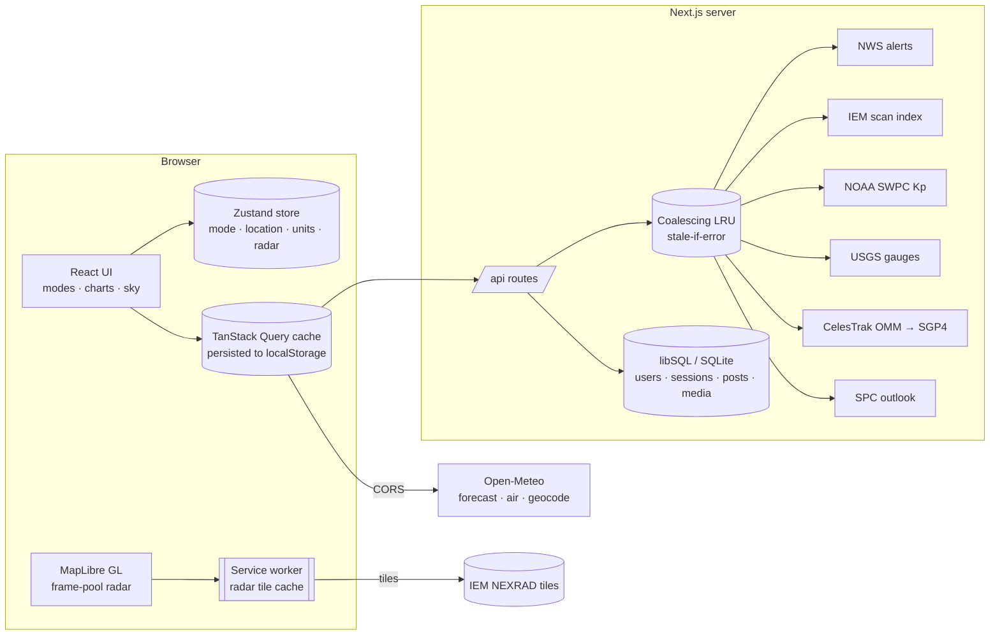

# Storm Central — System Architecture

Storm Central is a Next.js 16 (App Router) application. The browser does the heavy lifting where free APIs allow it (forecasts, radar tiles); a thin server layer proxies, reshapes and caches the feeds that need a User-Agent, shared caching or heavy computation. Community features (accounts, reports, photos) run on an embedded libSQL/SQLite database.



---

## 1. State management

State is split three ways, and each kind lives in exactly one place:

| Kind | Where | Why |
|---|---|---|
| **UI and preference state**: active mode, location, units, radar settings, drone profile | `src/store/app-store.ts` (Zustand + `persist`) | Tiny and synchronous. Any component can subscribe to one slice without context re-render cascades. |
| **Server state**: forecasts, alerts, scans, gauges, posts | TanStack Query (`src/hooks/queries.ts`) | Deduplication, background refetch, retries, `keepPreviousData` for flicker-free location changes. |
| **Shareable view state**: `?mode=&lat=&lon=&name=` | URL, two-way synced by `useUrlSync` | Any view can be linked. Sync uses `history.replaceState`, so it causes no router re-render. |

**Hydration safety.** The store is created with `skipHydration` and rehydrated in a client effect, so server HTML and the first client render match. A `hydrated` flag gates every query, which avoids fetching the default location before the user's saved location is restored.

**Modes are projections, not pages.** `src/modes/registry.ts` defines each mode's identity (label, short mobile label, line icon, hotkey, whether it is map-first) and a **polling policy** per feed:

| Feed | Daily | Severe | UAV | Angler | Air |
|---|---|---|---|---|---|
| Forecast (Open-Meteo) | 10 min | 5 min | 10 min | 10 min | 10 min |
| Local alerts | 5 min | **60 s** | 5 min | 5 min | 5 min |
| National warning polygons | — | **45 s** | — | — | — |
| Radar scan index | 2 min | **60 s** | — | — | — |
| Kp / GNSS | — | — | 15 / 10 min | — | — |
| River gauges | — | — | — | 10 min | — |
| Air quality | 30 min | — | — | — | 15 min |

All modes read the same normalised forecast (a columnar struct-of-arrays, stored in SI units), so switching modes never refetches cached data. Hovering or focusing a mode tab calls `prefetchMode()` to warm that mode's feeds, so the switch lands on data instead of skeletons. Each mode is a separate `next/dynamic` chunk; the map-heavy modes never download for a user who only reads Daily. Mode changes are a short opacity cross-fade. The UI uses one constant accent (see `docs/DESIGN.md`); colour is reserved for data and status, not per-mode theming. On phones, modes switch from a bottom tab bar, and Severe mode's controls live in a draggable bottom sheet.

Units are a presentation concern. Data stays SI and `formatters(units)` converts at render time, so toggling °F/°C is instant and never triggers a network request.

## 2. API polling and caching layers

There are four cache tiers, from the user outward:

1. **TanStack Query** keys round coordinates to about 1 km, so GPS jitter doesn't bust the cache. Refetching pauses in background tabs, and 4xx errors are never retried. Small location-scoped feeds (forecast, air, Kp) are persisted to `localStorage` for 24 h, so a cold start renders the last known conditions instantly.
2. **Service worker** (`public/sw.js`) serves timestamped radar tiles cache-first. They are immutable, so this is safe. The cache is bounded to 4,000 entries and 6 hours.
3. **Server coalescing cache** (`src/lib/feeds/cache.ts`) is a process-local LRU with **request coalescing**: during an outbreak, thousands of concurrent misses for the national warnings feed collapse into one upstream request. It is **stale-if-error**, so a flaky NWS endpoint keeps serving the last good payload.
4. **CDN**: every proxy response sets `s-maxage` plus `stale-while-revalidate`, so a deployment behind Vercel/Cloudflare absorbs most traffic at the edge. Feed responses also carry an **ETag**, so a poll that finds the data unchanged gets an empty 304. Location-keyed request URLs are rounded like their query keys, so nearby users share one cached response.

On Vercel, only `main` deploys (`vercel.json` `git.deploymentEnabled`; the Hobby plan counts even skipped builds toward its 100 deployments a day), and a commit that only touches the Shorts, live stream, server setup, website, docs, workflows or native-app folders skips the app's build.

Server routes also **reshape** the data. National alerts are filtered to storm-based polygons, enriched with NWS hazard colours, impact tags (PDS / emergency / destructive / observed), a severity rank and a parsed storm-motion vector. USGS series are downsampled to hourly values with computed 24 h change. CelesTrak elements are propagated server-side, so the browser receives about 3 KB of sky geometry instead of about 80 KB of orbital elements plus an SGP4 library.

Each route's logic is a **feed** (`src/lib/feeds/`): fetch, parse, cache, with no dependency on Next.js. The route handlers are one-line wrappers (`feedRoute(alertsFeed)`), and the Android app runs the same feeds on the phone (§8).

**Every hazard polygon** (`src/lib/feeds/hazards.ts`, `/api/hazards`). Besides storm-based warnings, the radar maps draw the rest of the watch/warning/advisory map. The NWS's own WWA map service (`mapservices.weather.noaa.gov`, the layer behind weather.gov's hazard map) supplies zone- and county-based products already drawn as polygons. The NWS API sends those without geometry, so this is the only practical source. Pieces of one product (one per zone) are joined by CAP id and generalised. The layer has no text, so these alerts go out **lean**, and the full text is fetched when one is opened (`/api/alerts?id=`). The same feed adds SPC mesoscale discussions and watch boxes and WPC precipitation discussions (from IEM), plus the national warnings of Canada (ECCC's OGC API) and Germany (DWD's WFS). Each source is cached and fails on its own. Every product is categorised (warning, watch, advisory, statement, marine, discussion) with the NWS hazard-map colour. The radar settings pick which categories every radar view draws: the radar mode, the daily preview and every Pro pane share `useMapAlerts`.

Every parser in `src/lib/feeds/parse.ts` is pure and tolerant of both legacy and current upstream layouts (for example, both SWPC JSON shapes). Each one is unit-tested against fixtures.

## 3. Memory-safe radar tile caching and animation

The radar pipeline has four stages:

```
IEM scan index ──► immutable frames ──► MapLibre frame pool ──► playback clock
 (/api/radar/scans)   (lib/radar/frames)   (lib/radar/layer-manager)   (hooks/use-radar-loop)
```

- **Frames are immutable.** Each frame is a RIDGE tile pyramid addressed by scan time, e.g. `ridge::TLX-N0B-202610071423/{z}/{x}/{y}.png`. Its id never changes, so frames are diffed by id, and the service worker can cache tiles forever (bounded by size and age).
- **Pre-buffered layer pool** (`RadarLayerManager`). Every frame gets its own raster source and layer at `raster-opacity: 0`. MapLibre fetches and uploads tiles for zero-opacity layers but skips drawing them, so the whole loop is prefetched into GPU textures at zero per-frame render cost. Animating is then a paint-property flip, with an optional cross-dissolve via `raster-opacity-transition`. No network requests or texture uploads happen on the hot path, so there is no stutter.
- **The newest frame is requested first.** Layers are added newest-first, so the current scan's tiles head the request queue.
- **Buffer-aware playback.** The manager tracks per-frame readiness from `sourcedata`/`idle` events. The clock (`nextPlayableIndex`) only advances onto buffered frames, so viewers never see a half-loaded frame. The timeline shows buffer state per tick, the last frame dwells 3.2× longer so "now" registers, and the cross-fade is clamped to 45 % of the frame interval so frames never double-expose at 4×.
- **Bounded memory.**
  - Frames are capped by `navigator.deviceMemory`: 8 frames at ≤2 GB, 12 at ≤4 GB, 20 above. A new volume scan adds exactly one source and evicts the oldest, freeing its GPU textures immediately, so memory stays flat no matter how long the loop runs.
  - Source `maxzoom` is 8 for the mosaic and 10 for single sites. Beyond that MapLibre over-zooms existing textures instead of fetching new tiles.
  - The map's `maxTileCacheSize: 48` caps each source's off-screen tile cache.
  - Worst case: 20 frames × (≈24 visible + 48 cached tiles) × 256 KB is bounded by design, and typical usage is far lower.
- **Graceful degradation.** If the IEM index is unreachable, the national mosaic falls back to IEM's rolling `-m05m…-m55m` composite layers, which need no index.
- **Discovery-driven product UI.** Available products and tilts per site come from IEM (`operation=products`), so the UI never offers a tilt or dual-pol product the radar isn't producing.
- **Future radar, extrapolated** (`lib/radar/nowcast.ts`, run in `nowcast.worker.ts`, driven by `hooks/use-nowcast.ts`). On the device, with no server involved, so it also works in the Android app:
  1. The worker draws the newest reflectivity scan and the one ~15 minutes before it onto a Web Mercator grid over the view, plus a 15 % margin, up to 768 px across. It uses the loop's own tiles, or one WMS image for NOAA. Drawing is nearest-pixel, so palette colours stay exact.
  2. It turns the colours into an echo-intensity proxy and block-matches it on a grid coarsened to ≥ 2 km pixels: 24 px blocks, ±14 px search, a sub-pixel parabola through the best match, and blocks without texture rejected.
  3. It cleans the vectors: a 3×3 median, inverse-distance fill for blocks without echoes, and the mean motion when the field disagrees with itself.
  4. Semi-Lagrangian advection traces each pixel back along the field, one 10-minute step further per frame, to make +10 … +60 minute PNGs that fade slightly with lead time.

  These frames are MapLibre image sources in the same frame pool, after the live scans, marked green on the timeline. The HRRR model frames (orange) pick up after them. The forecast is redone for each new scan, or when the view moves a quarter of its size or zooms ¾ of a level. The previous set stays up until the new one is ready. It's reflectivity only, and silently absent when there's too little echo, a scan's tiles didn't load, or the browser has no `OffscreenCanvas` in workers. Echoes keep their strength: no growth, decay or initiation, which the toggle says.

Overlays (warnings, storm tracks, SPC outlook, radar sites, spotter reports, AQI heat raster) are null-rendering React components that insert into named **z-order slots**: invisible marker layers created on map load. Stacking is therefore deterministic regardless of mount order, and radar renders beneath the basemap's place labels. Selections from map clicks go to React state and render in overlay panels (a bottom sheet on phones); user content is never injected into map popups as HTML.

The **satellite map** (`satellite-map-layer.tsx`, a toggle in the radar's layers and each Pro panel's settings) puts cloud-free pictures of the ground in place of the plain basemap: EOX's Sentinel-2 cloudless 2016 mosaic (10 m, worldwide, CC BY 4.0; the USGS imagery is sharper over the US but serves solid white tiles just across the borders). MapView records the style's own layer ids when it loads; the imagery goes just above the basemap's background, and the basemap's area fills (land, water, parks, buildings), which would cover it, are hidden while it's on. Its borders, roads and labels stay above, and nothing of ours is touched. Plugin imagery marked `"position": "below-radar"` goes into the `base` slot, under the GOES clouds and the radar.

## 4. Science modules (all pure, all unit-tested)

| Module | What it does |
|---|---|
| `astro/*` | Sun and moon ephemerides, refraction, twilight crossings, moon phase/illumination, solunar major and minor periods |
| `science/wind` | u/v vector math, bulk shear and veer, log-height wind interpolation |
| `science/atmosphere` | Magnus dew point, LCL, BKN/OVC ceiling estimate, density altitude, water-temperature estimate |
| `science/pressure` | Met Office/WMO 3-hour tendency terms |
| `science/dop` + `gnss` | SGP4 propagation, look angles, GDOP/PDOP/HDOP/VDOP |
| `science/storm-motion` | Parses NWS `eventMotionDescription`; projects storm tracks and computes an ETA corridor |
| `science/scores` | UAV flyability (encodes 14 CFR 107 visibility and cloud-clearance minimums) and angler Bite Index, each explaining its factors |
| `science/air` | EPA AQI (2024 PM2.5 breakpoints), NAB pollen scales, cleanest outdoor window |

## 5. Auth and community security model

- **Passwords:** Node's built-in scrypt (N=2^15, r=8, p=3), self-describing encoded parameters, `timingSafeEqual`, and a dummy verification for unknown users so response timing can't enumerate accounts.
- **Sessions:** a 256-bit opaque token in an `HttpOnly`, `SameSite=Lax`, `__Host-` cookie (production). Only its SHA-256 is stored. Sessions are sliding (30 days, extended in the second half of their life), and expired sessions are purged opportunistically.
- **CSRF:** every mutating route requires `Origin` to match `Host`, in addition to SameSite.
- **Rate limits:** sliding-window limits per IP and per account for login (stuffing and spraying), registration, posting, verifying and commenting.
- **Uploads:** client re-encodes photos to ≤1600 px WebP, which drops metadata. The server **does not trust the client**: it sniffs magic bytes, strips JPEG APP1/APP13/COM, PNG text/eXIf chunks and WebP EXIF/XMP chunks (fixing VP8X flags and the RIFF size), and serves media with `nosniff` and a sandboxing CSP.
- **Privacy:** report coordinates are rounded to about 1 km unless the user opts in to precise GPS.
- **Confirmed by NWS** (`src/lib/nws-match.ts`, `src/lib/server/nws-sync.ts`): a report whose kind, place (within 15 km) and time (the NWS event up to an hour before posting or half an hour after) match one of the NWS's Local Storm Reports (IEM's archive, the storm-reports feed) is marked confirmed, keeps that report's type, size, place and time, and counts as 5 confirmations toward its author's rank. The match runs after posts and activity requests (`after()`), at most every 10 minutes per server instance, over the last day's unconfirmed reports, so there is no cron job or secret. The author hears about it through report activity notifications.
- **mPING** (`src/lib/mping.ts`, `src/lib/server/mping.ts`): with `MPING_TOKEN` set (mPING grants tokens on request), the composer offers "Also send to NOAA's mPING" for the kinds mPING takes, with mPING's detail (hail size, wind damage, flood type, precipitation or visibility type). After the report is posted, the server sends mPING the type, the time and the same rounded position everyone sees, never the name, and keeps mPING's id. The ids for each type come from mPING's own description list (cached a day) by name, so nothing hard-codes them. Without a token nothing is offered or sent.
- **CSP:** an allow-list of the upstream origins the browser talks to directly (scripts, frames and fonts stay on it), with images and connections also allowed to any HTTPS host so map plugins can add their own tiles; plus `frame-ancestors 'none'` and `object-src 'none'`.
- Cascading deletes are explicit (batch) because libSQL's connection pool doesn't guarantee `PRAGMA foreign_keys` per connection.
- **Spotter warnings (WarnGen, §9):** members only. Listing them requires a session (401 otherwise), so they never reach the public. Issuing takes the Trusted Spotter rank (25 confirmations of your reports, or granted by username in `TRUSTED_SPOTTERS` / `session.ts`), or `WARNGEN_MIN_REPUTATION`; moderators and developers always can. Issuing is rate-limited (8 per 15 minutes) and capped at 6 active warnings per spotter. The server re-validates every field: the polygon's size, corner count and self-intersection; the product's criteria; and place names as plain text. Only the issuer updates a warning; the issuer or a moderator cancels it. A suspended account's warnings are hidden like its reports.
- **Storm chasers (live positions):** opt-in, off by default, per device (Settings → Account: share for 1, 4 or 12 hours). While it's on and the app is open, `ChaserBeacon` watches the GPS and sends `PUT /api/chasers` at most every ~50 s, sooner after a 300 m move, never within 20 s (the server takes one update per 15 s per account). Only signed-in members can list positions (401 otherwise, `private, no-store`), with blocked people (both ways) and suspended accounts left out. The server keeps just the latest fix per person, rounded to ~10 m, in `chaser_positions`: no history. A position leaves the map 15 minutes after its last update and is deleted when its window ends (at most 12 hours), when sharing is switched off, on sign-out, and with the account. The map layer (Storm chasers, off by default) polls once a minute only while it's on and the tab is visible. A chaser can link their YouTube channel or live video (checked by `parseStream`: YouTube addresses only); their card then has Watch live, and the map labels them LIVE while that stream is live.
- **Live storm chaser streams** (`src/lib/chaser-streams.ts`, `src/lib/server/chaser-streams.ts`, `/api/chaser-streams`, the radar's Chasers tab): which storm chasers are live on YouTube, to watch in the app. The list is a hand-checked set of chaser channels plus `CHASER_CHANNELS`, plus the channels linked by chasers sharing their position right now (only the links are read, never the positions). Each channel's public RSS feed gives its newest videos, and one YouTube Data API `videos.list` call (1 quota unit per 50 videos, `YOUTUBE_API_KEY`) says which are live; handles become channel ids once a week. The response is public YouTube data, cached two minutes in the server and the CDN, so it stays far under YouTube's 10,000 daily units and costs Vercel one run per two minutes. Without a key, the tab lists the channels to open on YouTube. Streams play in a `youtube-nocookie.com` embed (CSP `frame-src`). Spotter Network positions aren't used: its terms don't allow redistributing them without an agreement.

## 6. Rendering the sky

`WeatherBackground` computes the **true solar altitude** at the selected location (refreshed every 5 minutes) to pick night, astronomical, nautical and civil twilight, golden hour or day palettes. All palettes fall to true black at the bottom (OLED-friendly, text-safe). On top of that:

- Motion-driven cloud blobs scaled by cloud cover and pushed by the real east–west wind component.
- A Canvas2D precipitation engine: one batched path per frame, DPR capped at 1.5, particle budget scaled to screen area and to both WMO intensity and measured mm/h. Wind sets the rain slant.
- Procedural lightning for convective codes, plus fog banks and twinkling stars.

The loop parks when the tab is hidden, pauses under immersive map modes, and renders a single static frame under `prefers-reduced-motion`.

## 7. Testing

`npm test` runs Vitest across astronomy (validated against real 2024 moon phases and a Chicago solstice sunset), wind and pressure science, scoring, DOP, storm-motion ETA, radar frame/playback/layer-manager logic (with a mock map), upstream parsers, image metadata stripping, password hashing, chart geometry and a schema-drift test that runs every table through Drizzle on a database created from the bootstrap DDL. A registry test checks that every feed route is also available to the Android app's in-app dispatcher, so the two can't drift apart.

## 8. Desktop and Android apps

```
                 ┌─ web ──────► next build ──────────────► Node host / Vercel
src/ (one app) ──┼─ desktop ──► standalone server ─► Electron (desktop/) ─► NSIS installer, Store .appx
                 └─ mobile ───► static export ────► Capacitor (android/) ─► APK
```

`BUILD_TARGET` in `next.config.ts` selects the output; `scripts/build-native.mjs` drives the native builds.

**Windows (Electron).** `desktop/server.mjs` runs the `standalone` Next.js server in an Electron utility process, bound to `127.0.0.1:47613`. The port is fixed so the UI keeps one origin, and with it its localStorage and query cache, across launches. Because the app's own server runs locally, every feature works offline from any hosting, including accounts: the SQLite database lives in the user's app-data folder, outside the install directory that updates replace. Running on loopback HTTP needs two server settings. `SESSION_COOKIE_SECURE=false` drops the `__Host-`/Secure cookie, which plain HTTP can't carry. `ALLOWED_HOST` pins the Host header for writes, so a DNS-rebinding page can't reach the local database. The window is sandboxed with context isolation and no Node integration, navigation is locked to the app's origin (other links open in the default browser), and only geolocation, notifications, clipboard-write and fullscreen permissions are granted. electron-updater checks GitHub Releases on launch and every 4 hours, downloads in the background, and asks before restarting.

**Android (Capacitor).** A static export can't include route handlers, cookies or server-rendered pages. Its build uses `pageExtensions: ["tsx"]`, which drops every `route.ts` along with pages named `*.server.tsx` (profiles and moderation). `getJson()` sends `/api/*` requests to `lib/native/local-api.ts` instead, which runs the matching feed in-process with `CapacitorHttp`, the platform's HTTP stack. That way NWS, SPC, USGS and CelesTrak work despite missing CORS headers, and the NWS User-Agent can be set. The cache keeps CelesTrak elements in localStorage for 6 hours, which honours CelesTrak's re-download etiquette across app restarts. GNSS needs SGP4 in the browser, so `lib/science/sgp4.ts` imports satellite.js's pure-JS modules directly, bypassing its WASM entry. The spotter network needs the shared database. `COMMUNITY_ENABLED` is false in this build, which hides its entry points. The web view runs edge-to-edge, and the layout pads its fixed chrome with `env(safe-area-inset-*)`. The app checks the latest GitHub release at most every 6 hours and offers the new APK.

**Hosted mode.** Release builds load the hosted site (https://storm-central-pi.vercel.app, or the `STORMCENTRAL_URL` repository variable): Electron loads the URL, Capacitor uses `server.url`. Every user shares one spotter network, and web changes reach the apps on deploy, without a new release. Local builds without it run standalone as described above.

**Releases.** `.github/workflows/release.yml` checks the code (typecheck, lint, tests). It then builds the installer on Windows and smoke-tests the bundled server's native database module there, and builds the APK on Linux. For a `v<version>` tag matching `package.json`, it publishes one GitHub release with `StormCentral-Setup-<version>.exe`, its blockmap, `latest.yml` (the electron-updater feed), the Microsoft Store `.appx` and `StormCentral-<version>.apk`, deletes all but the two newest releases, and republishes the GitHub Pages download site.

Signing is optional; without it the builds still work:

| Setting (repository) | Kind | What it does |
|---|---|---|
| `ANDROID_KEYSTORE_BASE64`, `ANDROID_KEYSTORE_PASSWORD`, `ANDROID_KEY_ALIAS`, `ANDROID_KEY_PASSWORD` | secrets | Sign the APK with your own key (`base64 -w0 release.keystore`). Without them it's signed with the shared development key, and phones won't update across a key change. |
| `WINDOWS_CERTIFICATE`, `WINDOWS_CERTIFICATE_PASSWORD` | secrets | Code-sign the installer (base64 .pfx). Without them Windows SmartScreen warns on first run. |
| `MSIX_IDENTITY_NAME`, `MSIX_PUBLISHER`, `MSIX_PUBLISHER_DISPLAY_NAME` | variables | The Store package identity from Partner Center (Product identity page). |
| `STORMCENTRAL_URL`, `PRO_SERVER_URL` | variables | The hosted site the apps load, and the Pro data server. |

## 9. Professional mode

An AWIPS II / CAVE-style workspace, off by default (**Settings → General → Professional mode** adds the **Pro** mode, hotkey `6`). It lives in `src/components/pro/` and `src/lib/pro/`, and loads as its own chunk like the other map modes.

```
ProfessionalWorkspace          sync bus (zustand/vanilla) + pane registry + tool actions (React context)
├─ ProToolbar                  layout 1×1 · 1×2 · 2×2 · 3×3, radar site, tool, loop transport (Zulu clock)
├─ Pane × 1–9                  one MapLibre map each
│  ├─ FrameSource              per product kind: site (useRadarLoop) · decoded L2/L3 · mosaic · MRMS · other countries · server · satellite
│  ├─ ProFrames                RadarLayerManager frame pool, stepped by the sync clock
│  ├─ CameraSync, CursorSync   imperative subscriptions: jumpTo / crosshair transform
│  ├─ WarningsLayer (all hazards + spotter warnings), StormCellsLayer, ToolOverlay (A–A′, vector, TOA fan), WarnGenOverlay, ToolClicks
│  └─ PaneHeader               product, tilt, opacity, overlays; frame time written to the DOM
├─ side panel                  SoundingPanel (SkewT + Hodograph) · CrossSectionPanel · StormToolsPanel · WarnGenPanel · IbwInspector / AlertDetail
└─ ReadoutHud                  lat/lon, ground height, range/bearing, every pane's value, model fields
```

**State.** Settings that should survive a reload (layout, each pane's product/tilt/opacity/overlays, site, frame count, speed) are a persisted Zustand store, `src/store/pro-store.ts`. The fast-changing shared view is a separate **vanilla** store, `src/lib/pro/sync.ts`: camera `{lng, lat, zoom, source}`, the loop `timeline`/`index`/`playing`, the time-basis pane's buffer status, and the cursor. Panes subscribe to it outside React and apply changes straight to MapLibre, so panning a 3×3 layout or stepping the loop renders no React components. Only the small widgets that display these values read them through `useProSync`, and the frame clocks write their text node directly.

**Several monitors.** Any panel, and the analysis panel (sounding, cross-section, storm tools, WarnGen, warning inspector), can be popped out into a window of its own (`/pro-window?view=p2` or `view=panel`), the way AWIPS spreads across three or four screens. The windows stay one workspace over a `BroadcastChannel` (`lib/pro/link.ts`, same origin only):
- The camera and cursor go both ways, tagged with the pane that moved them, so nothing echoes. So do the loop index and play state.
- The timeline comes from the workspace, whose time-basis panel (the first one it still shows) sets it.
- The Pro store's shared settings and tool state go both ways, and so do the analysis tools' points.
- A new pop-out says hello and the workspace sends it everything. Pop-outs then report every two seconds, so the workspace leaves their places empty with a "Bring it back" button, and takes a panel back when its window closes or goes quiet. Only the workspace runs the loop clock.

In the desktop app, a pop-out opens on a monitor other than the workspace's, filling it the first time and where it was left after that. Pop-outs hide, show and close with the main window. In a browser it's an ordinary window to drag across.

**The guide (optional).** The toolbar's Guide button opens a reference in the side panel (`guide-panel.tsx`): the basics, every product and tool (what it shows, how to read it, what to look for), how-tos and a glossary, all searchable. From there an optional tour (`pro-tour.tsx`) walks through the workspace, highlighting each part by its `data-tour` attribute and skipping any that aren't on screen. Nothing opens by itself, and Settings → Professional mode can hide the button. The content lives in `lib/pro/guide.ts` as translation keys; its tests check that every product and tool has an entry, that every string has Spanish, and that each tour stop names an element the workspace marks.

**Spatial sync.** A move event that carries user input (`originalEvent`) is published with the pane's id; the other panes `jumpTo` it. Programmatic jumps carry no input event, so they're never re-published, and there's no echo loop or "who leads" logic.

**Temporal sync.** AWIPS-style time matching: the first radar pane is the **time basis** (marked `TB`) and the loop steps through its scan times, waiting on frames that pane hasn't buffered. Every pane shows its newest frame at or before the clock (`frameAt`), so products that scan at different times (super-res reflectivity, IEM dual-pol, 2-minute MRMS, 10-minute GOES) stay on the same moment. Satellite frames are stamped with the loop time they pair with (scan time + GIBS latency).

**Decoded NEXRAD** (`lib/pro/nexrad/`). Products the tile services don't carry are read straight from NOAA's Open Data buckets on AWS, which are public and CORS-open:
- **Level III** (`unidata-nexrad-level3`, a few KB per file, about 5 minutes behind the scan): CC, ZDR, HC and KDP at all six published tilts, reflectivity and velocity above 0.5°, digital VIL and enhanced echo tops. On every device.
- **Level II** (`unidata-nexrad-level2`, 2–20 MB per volume, about 11 minutes behind): any cut of the volume up to 19.5° for Z, V, ZDR and ρHV. Desktop only.
- **Real-time Level II** (`unidata-nexrad-level2-chunks`): the volumes the archive bucket doesn't have yet, published as they're scanned in chunks of about 120 radials (`KTLX/893/20261020-181800-001-S`: volume number 1–999 in a cycle, scan start, chunk number, Start/Intermediate/End). Concatenated in order, the chunks so far are an ordinary Archive II file, so the same decoder reads them and reports whether the requested cut is complete. `liveVolumes` finds the volume being scanned once (the gaps in the cycle of volume numbers narrow it down, the scan times decide), then polls with two small listings; finished volumes are cached. Each poll decodes the newest volume's chunks again until the cut is complete (`liveJob` keeps that decode from then on, and earlier partial decodes are dropped). The lowest tilt is complete about a minute after its scan starts, instead of eleven.

The decoders are our own TypeScript, with no dependencies: `bzip2.ts`, `level3.ts` (packet 16 digital radials, per-product scaling from the threshold halfwords) and `level2.ts` (Message 31, with the cut list from the VCP in Message 5, and the legacy Message 1 of volumes from before 2008; it stops decompressing once the requested cut is complete). The available npm decoders don't cover the dual-pol Level III products and need Node's `Buffer`. Tests check them against MetPy, value for value, on real KTLX files in `__fixtures__/`.

Decoding runs in a pool of Web Workers (`decode.worker.ts`), which hand back the compact sweep and a colour per raw level. The map draws it on the GPU (`sweep-layer.ts`, a MapLibre custom layer): each sweep in the loop is uploaded once as integer textures (levels as gates × radials, the colour table, a 0.1° azimuth → radial lookup), and a fragment shader takes every screen pixel back to the radar's polar grid by 4/3-earth beam geometry (great-circle distance and bearing, then slant range for the sweep's elevation) and reads the gate under it. Gates stay sharp at any zoom, nothing is rendered to an image or encoded, and stepping the loop only rebinds textures. The frame pool sends frames that carry a sweep (`RadarFrame.sweep`) to one such layer per panel and everything else to raster sources, and the cursor readout reads the exact gate value from the same sweep (`levelAt`, the shader's math on the CPU).

**Damaged and incomplete volumes.** Feeds drop radials, cut volumes short and occasionally hand over corrupt records, especially on busy severe days. The decoders lose only what's damaged:
- bzip2 checks every block's CRC, so a corrupted download that still parses can't come out as plausible-looking radar.
- A record that fails to decompress loses its wedge of radials and the rest of the volume still decodes. A bad message (a data block pointing past its end, nonsense gate counts or word sizes) loses that radial. A radial whose gate geometry or scaling disagrees with the sweep's is dropped. All of it is counted in `damaged`.
- A file cut short (a dropped download, a volume still arriving) gives what arrived, marked incomplete.
- In the azimuth lookup, gaps up to 1.5° (a dropped radial or two) are filled from both sides. Wider ones (a lost record, a sweep still being scanned) stay empty rather than smearing the nearest radial around the circle.
- A volume without the requested cut, or one that fails outright, is left out of the loop, and the loop plays the frames it has.
- A decode stuck for two minutes, or a worker that crashes, replaces the worker pool, and the jobs it held are retried later.
- The GPU layer skips a sweep it can't hold, catches its own errors (one bad frame can't stop the map drawing), and uploads again after the WebGL context is lost and restored.

**Cursor sampling** for tile products: the tile services return rendered PNGs, not data, so values are read back from colour (`lib/pro/sample.ts`). The tile under the cursor is fetched once (LRU of decoded tiles), and the pixel is matched to the closest point on the colour scale that drew it, interpolating between stops. NOAA's scales (`lib/pro/scales.ts`) were sampled from its own legend images and pinned to their printed values (reflectivity, super-res velocity with range folding, echo tops); IEM's tiles use the radar mode's legends. These values are shown as approximate (≈).

**Pro data server** (`pro-server/`, optional). Some products need channel math or GRIB2 decoding on files too big for a browser:
- GOES Day Cloud Phase Distinction, Nighttime Microphysics (night fog) and IR Sandwich from raw ABI bands.
- MRMS hail size (MESH), rotation tracks and VIL.
- Lightning: every GOES GLM flash of the last 15 minutes from GOES-East and -West (`lightning.json`), which the radar map draws as bolts coloured by age. Without a server the map puts a bolt on each cell of nowCOAST's strike-density grid instead (`boltsFromDensity`).

A small Python service renders them on a schedule (satpy for the RGB recipes, GRIB2 decoding for MRMS). It publishes `index.json` plus Web Mercator PNGs, built to run on a free Oracle Cloud VM. Memory stays flat over long runs: the freed heap goes back to the OS after every frame, everything it keeps (frames, flashes, files seen) is pruned as it goes, and past a memory limit it restarts itself cleanly between cycles. The app gets its address at build time (`NEXT_PUBLIC_PRO_SERVER` on Vercel, the `PRO_SERVER_URL` variable in the release workflow), so every user has the products once one runs. Until then they're left out of the product menus, like Level II on phones, and a saved panel showing one switches to the nearest product that works.

**Other countries' radar** (`lib/radar/intl.ts`). Outside NEXRAD coverage, national weather services' own composites serve CORS-open WMS or XYZ tiles: Canada (ECCC GeoMet, 1 km North American composite, 6 min), Germany (DWD), Finland (FMI), the Netherlands (KNMI) and Japan (JMA's high-resolution nowcast, observed frames only), each verified from a CI runner. `/api/radar/intl` lists each source's times, from WMS capabilities, JMA's time list, or the fixed grid for services whose capabilities are slow to build. In the radar mode they sit under NOAA's radar and are **time-matched** to the loop: each loop frame shows each source's latest scan at or before it, within two scan intervals. Only sources whose coverage is in view are fetched, and raster sources carry `bounds`, so no tiles are requested outside it. In Pro they are products of their own ("Radar (other countries)"), stepped by the same loop clock. Agencies that need an API key (Météo-France, the Met Office, AEMET) or publish only HDF5 files (SMHI, DMI, MeteoSwiss) aren't included.

**Spotter WarnGen** (`lib/warngen/`, `warngen-panel.tsx`, `warngen-overlay.tsx`). A WarnGen-style editor for the built-in spotter network, never the public or the NWS:
- **Pick the storm.** Click it on any pane ("drag me to storm"), then again on another frame to track it, or type the motion in. The pick is carried forward to the present along its motion.
- **The polygon.** Drawn the way AWIPS WarnGen draws it: a box that starts just behind the storm and widens down the projected track for the warning's duration, or an octagon for a stationary storm. Corners can be dragged on any pane, midpoints dragged to add a corner, and corners right-clicked or double-clicked away.
- **Products.** Tornado, severe thunderstorm, flash flood and snow squall warnings, and significant weather advisories. Each takes its IBW tags: source, hail size, wind gust, tornado possible, and a damage threat including PDS and emergency tiers. The editor enforces the NWS criteria; for example, a severe warning needs 1-inch hail or 58 mph wind.
- **The text.** Generated like a WarnGen product (bullets, HAZARD/SOURCE/IMPACT, call to action, `LAT...LON` and `TIME...MOT...LOC`, IBW tags). Towns come from reverse-geocoding points inside the polygon. The text is headed and signed as an unofficial spotter-network product, and is regenerated from the stored fields in each viewer's time zone.
- **Storage and display.** Warnings live in the `spotter_warnings` table with per-year numbers and can be updated (revisions) or cancelled. Every radar view draws them for signed-in members, dashed and labelled "SPOTTER". They open in the same detail panel as NWS alerts, with an unofficial banner.

### Still not covered

| Gap | Why | Path |
|---|---|---|
| Raw GRIB2 in the browser (HRRR native levels, RAP) | No practical browser decoder for JPEG2000/CCSDS-packed fields | Add them to the Pro data server ([ecCodes](https://confluence.ecmwf.int/display/ECC) / `cfgrib`), or keep using Open-Meteo |

## 10. Radar archive

The radar views can look back at any minute since 1995. One app-wide time, `archiveAt` in the app store (not persisted, shared as `?at=2013-05-20T20:00Z` by `useUrlSync`), switches every radar view from live to that moment; `null` is live. `lib/radar/archive.ts` holds the range check (`archiveTime`), wall-clock conversion for the picker (times are entered in the location's zone, like every other time on screen) and the list of notable storms.

| Data | Source | Back to |
|---|---|---|
| National mosaic | IEM's composite tiles (`ridge::USCOMP-N0R-…` until about 2010, N0Q since), listed by `radar.py` with `end` | 1995 |
| Warnings in effect | IEM's storm-based warning archive (`sbw.geojson?ts=`); county-based before October 2007 | 1995 |
| Storm reports | IEM's local storm reports (`lsr.geojson?sts&ets`) | mid-2000s |
| Level II volumes (Pro) | `unidata-nexrad-level2` on AWS: gzipped `AR2V`/`ARCHIVE2` files with Message 1 radials before 2008 | 1995 |
| Level III products (Pro) | `unidata-nexrad-level3` on AWS: N0Q/N0U and dual-pol from April 2020, super-res N0B/N0G from February 2022 | April 2020 |

The feeds take the time as a parameter (`/api/radar/scans?end=`, `/api/storm-reports?end=`, `/api/alerts?at=`) and, once it has settled (an hour; a day for storm reports, which keep arriving), are cached for a day (`archiveMaxAge`). Their hooks stop polling. Archived warnings (`parseIemWarnings`) come out as the same `WeatherAlert`s as live ones, with tags and rank from the shared `impactTags`, and their text loads from IEM's product archive when opened.

- **Radar mode** shows the national mosaic only (IEM's single-site tiles aren't archived), the warnings then in effect and the storm reports of the hours before. Layers with no archive (cells, outlooks, satellite, lightning, other countries, cameras, chasers, spotter reports) are hidden while looking back, and the archive time stands in for "now" in every relative time. The timeline carries an archive button; while looking back, a strip above it shows the time, steps an hour either way and returns to live.
- **Professional mode** reads each product from its own archive: `FrameSource` passes the time to the loaders, which list the AWS buckets up to it (`listLevel2/3(…, until)`). The lowest tilt of reflectivity and velocity comes from Level III too (the live tiles have no archive), falling back to N0Q/N0U before 2022; before April 2020 a desktop reads those panels from the Level II volume instead, at the panel's tilt. Products with no archive (MRMS, the Pro data server, satellite, other countries) say so in the panel (`archiveNote`). Volumes from before 2008 don't carry the radar's location, so jobs pass it from the site table. Model soundings and cross-sections stay current, and WarnGen is live only.

